<div align="center">


**A short, personalised audio news brief, waiting for you every morning.**

[Live demo](https://piyush-sir-project.vercel.app)

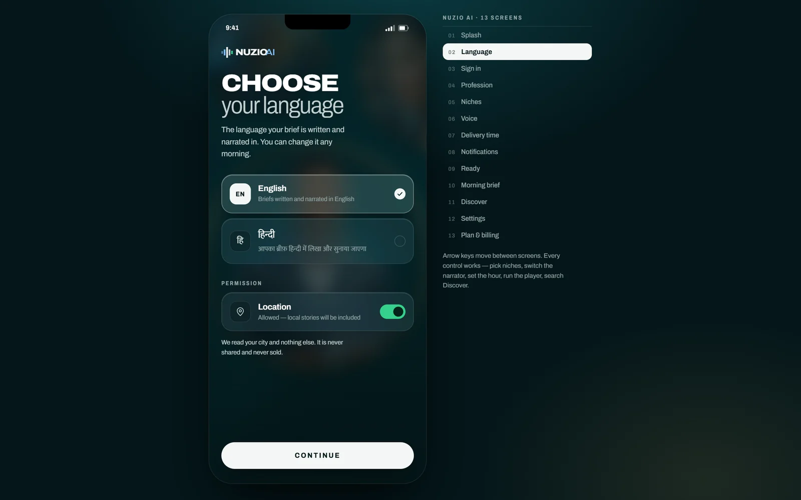

</div>

## What it is

The listener picks a language, a set of niches, a narrator, a length and a delivery hour. Nuzio assembles and narrates a brief that matches those choices and has it ready at that time.

On a desktop the app runs inside a phone frame, with a rail on the right that jumps to any of the thirteen screens. The arrow keys move between screens. On a phone it runs full screen.

## The flow

<table>
  <tr>
    <td align="center" width="25%">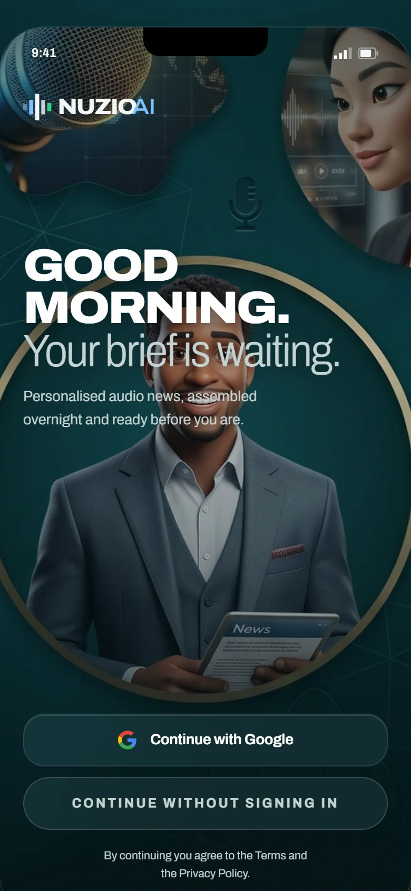<br><sub><b>Welcome</b><br>Google sign-in, or continue without an account</sub></td>
    <td align="center" width="25%">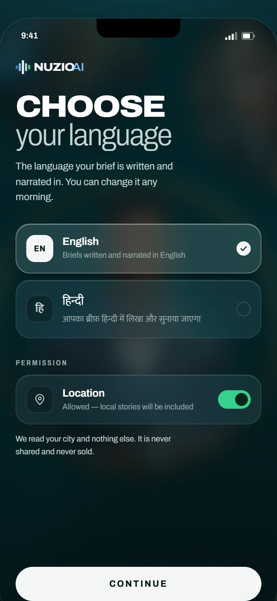<br><sub><b>Language</b><br>English or Hindi, plus optional location</sub></td>
    <td align="center" width="25%">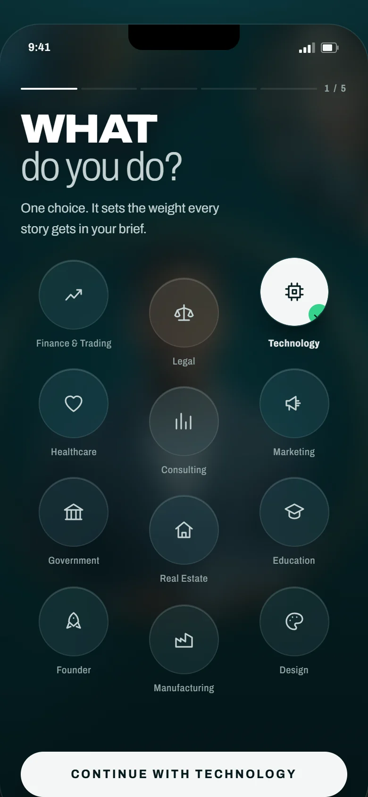<br><sub><b>Profession</b><br>sets the weight of every story</sub></td>
    <td align="center" width="25%">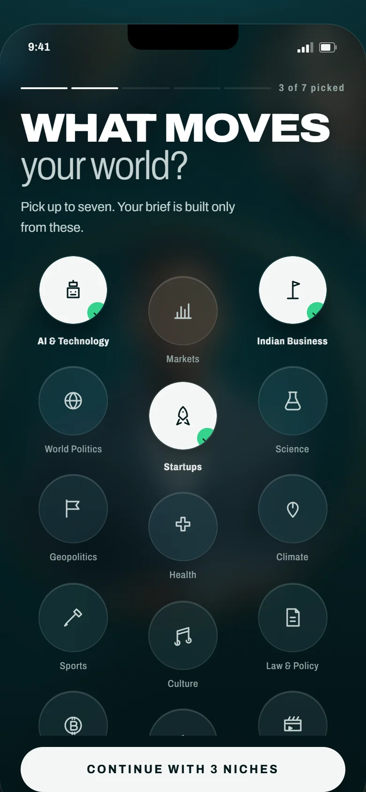<br><sub><b>Niches</b><br>pick the topics that move your world</sub></td>
  </tr>
  <tr>
    <td align="center">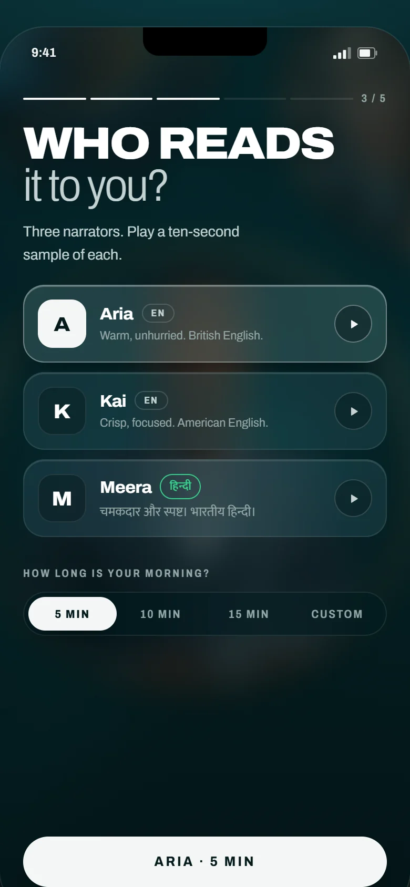<br><sub><b>Narrator</b><br>three voices, each with a sample, and a length</sub></td>
    <td align="center">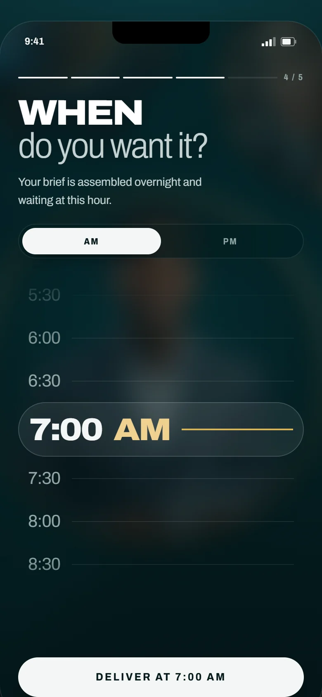<br><sub><b>Delivery</b><br>the brief is assembled overnight for this hour</sub></td>
    <td align="center">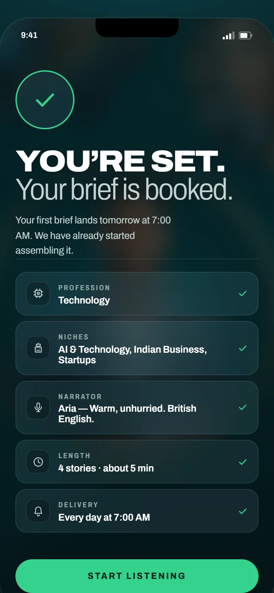<br><sub><b>You're set</b><br>a summary of every choice</sub></td>
    <td align="center">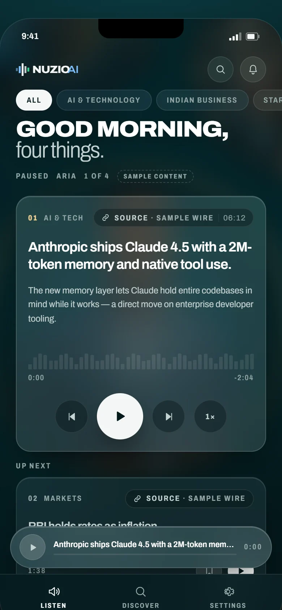<br><sub><b>Listen</b><br>today's brief with the player</sub></td>
  </tr>
  <tr>
    <td align="center">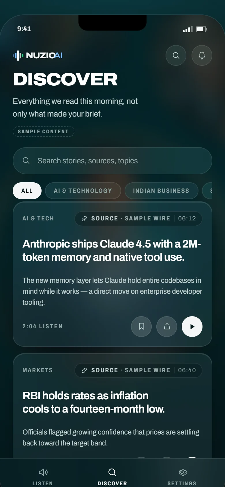<br><sub><b>Discover</b><br>search stories, sources and topics</sub></td>
    <td align="center">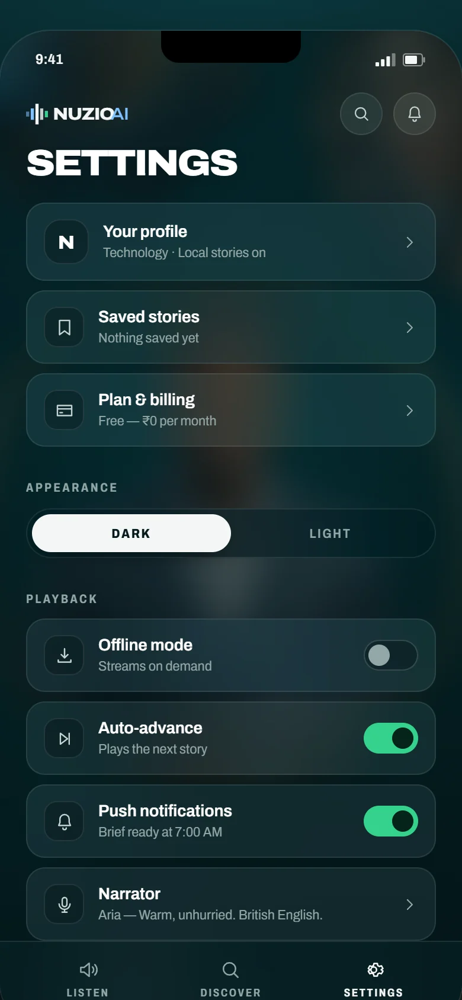<br><sub><b>Settings</b><br>profile, saved stories, playback</sub></td>
    <td align="center">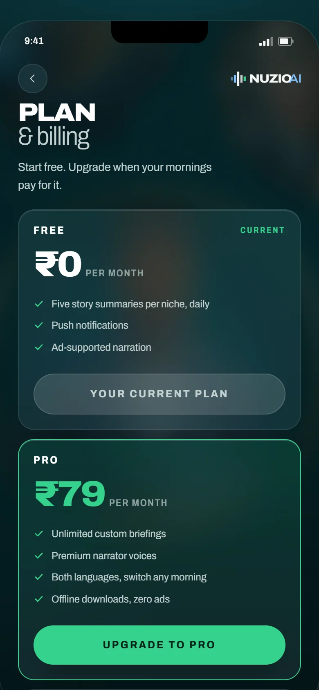<br><sub><b>Plan &amp; billing</b><br>Free and Pro (₹79 a month)</sub></td>
    <td></td>
  </tr>
</table>

## Layout

```
frontend/   React + Vite app: every screen, the player, the design system
backend/    Supabase schema: tables, row level security, triggers, seed data
```

The two halves are independent. The frontend runs with no backend at all. With no Supabase credentials it falls back to a bundled catalog and placeholder editorial, and preferences are saved to `localStorage` instead of a profile row. Add credentials and the same screens read and write Postgres.

## Run the frontend

```bash
cd frontend
npm install
npm run dev        # http://localhost:5173
```

## Backend

A Supabase project URL and anon key are baked into `frontend/src/lib/supabase.js`, so a deployed build needs no environment configuration. To point the app at a different project, copy `frontend/.env.example` to `frontend/.env.local` and fill it in. An env var overrides the baked-in default.

To set up a project from scratch:

1. Create a Supabase project.
2. Apply the schema and seed. The connection string is in Project Settings → Database → Connection string → URI:

   ```bash
   cd backend && npm install
   DATABASE_URL='postgresql://...' npm run apply
   ```

   It prints the resulting row counts. Other routes are in [backend/README.md](backend/README.md).
3. Enable the Google provider under Authentication → Providers, and add your deployed origin to the redirect allow-list.

With the seed applied, the catalog and feed come from Postgres. Without it, every screen still works on the bundled catalog. With Google enabled, sign-in is a real redirect and onboarding writes to a profile row. Without it, "Continue without signing in" walks through the same flow on local state.

## Build and deploy

```bash
cd frontend && npm run build   # -> frontend/dist
```

Import the repository into Vercel and press Deploy. `vercel.json` carries the install command, the build command and the output directory. Leave **Root Directory** at the repository root (or set it to `frontend`; `frontend/vercel.json` covers that case). After the first deploy, add the deployment origin to the Supabase redirect allow-list (Authentication → URL Configuration), or Google sign-in will bounce.

## Status

The prototype is complete and clickable end to end. All editorial is placeholder, flagged in the UI with a SAMPLE marker. No real journalism and no real outlet is attributed anywhere. Audio narration and brief assembly are not built yet; the player runs on a timer against declared run lengths.
